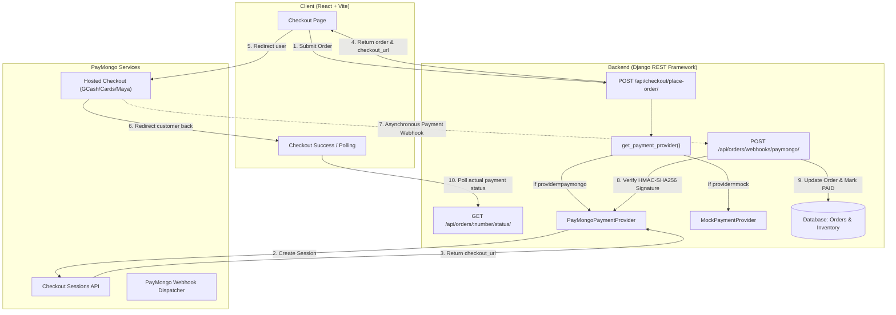

# Studio Payment Architecture

This document details the payment gateway integration architecture for Studio / Fashion Commerce Platform.

---

## 1. Overview & Provider Abstraction

Studio supports pluggable payment providers configured via environment variables. The system isolates third-party gateway dependencies behind clean provider interfaces so the application can operate in:
1. **Mock Mode** (`PAYMENTS_PROVIDER=mock`): Zero external network calls; supports local UI demos, offline development, and automated CI test runs.
2. **PayMongo Mode** (`PAYMENTS_PROVIDER=paymongo`): Direct integration with PayMongo Checkout Sessions API and webhook verification.

### Architecture Diagram



---

## 2. Directory Structure

Payment-related logic is organized under `apps/orders/payments/`:

```text
apps/orders/payments/
├── __init__.py           # Exports public classes & factory
├── base.py               # Abstract BasePaymentProvider & dataclasses
├── exceptions.py         # Custom payment exceptions
├── factory.py            # Provider resolution (get_payment_provider)
├── mock_provider.py      # MockPaymentProvider implementation
└── paymongo_provider.py  # PayMongoPaymentProvider implementation
```

---

## 3. Order & Payment Lifecycle

The system utilizes an explicit lifecycle for order and payment statuses:

| Status | Meaning |
| :--- | :--- |
| `pending` | Order created and payment session active; awaiting customer payment or webhook. |
| `paid` | Webhook verified successful payment; order confirmed and ready for processing. |
| `processing` | Merchant is preparing the order items for shipment. |
| `shipped` | Order handed to carrier with tracking number. |
| `delivered` | Package delivered to recipient. |
| `cancelled` | Order cancelled by customer or staff before shipment. |
| `failed` | Payment failed or was rejected by PayMongo. |
| `expired` | Checkout session expired without payment. |
| `requires_action` | Safe exception path: payment received, but inventory reservation issue flagged for manual review. |

### Data Model Enhancements

The `Order` model includes dedicated fields for payment tracking:
* `payment_provider`: `"paymongo"` or `"mock"`.
* `payment_reference`: PayMongo Checkout Session ID (`cs_...`) or mock session ID.
* `payment_transaction_id`: PayMongo Payment Transaction ID (`pay_...`).
* `payment_status`: `"unpaid"`, `"pending"`, `"paid"`, `"failed"`, `"expired"`, `"cancelled"`.
* `checkout_url`: URL of the PayMongo hosted checkout session.
* `payment_data`: Non-sensitive session metadata (client keys, fee info, source types).
* `is_stock_deducted`: Boolean flag preventing duplicate stock deductions.

---

## 4. Inventory & Concurrency Safety

To eliminate overselling and race conditions:

1. **Variant-Level Stock Reservation**:
   * Stock is tracked independently per size and color SKU (`ProductVariant.stock`).
   * When `place_order` is executed, variants are locked inside an atomic database transaction using:
     ```python
     ProductVariant.objects.select_for_update().filter(id__in=variant_ids)
     ```
   * Stock is reserved immediately upon checkout session creation, and `order.is_stock_deducted = True`.
2. **Preventing Duplicate Deductions**:
   * When a verified `checkout_session.payment.paid` webhook arrives, the system checks `order.is_stock_deducted`. Since stock was pre-reserved, stock is **not** decremented a second time.
3. **Automatic Restock on Expiration/Cancellation**:
   * If customer cancels the order, payment fails (`payment.failed`), or the checkout session expires (`checkout_session.expired`), stock is restored via atomic increment:
     ```python
     ProductVariant.objects.filter(...).update(stock=F("stock") + item.quantity)
     order.is_stock_deducted = False
     ```
4. **Safe Manual Review Exception Path**:
   * If for any reason payment is captured but inventory cannot be fulfilled, the order status is safely set to `requires_action` with a detailed audit entry in `order.timeline`. Payment is never discarded, and overselling is prevented.

---

## 5. Webhook Security & Idempotency

Webhooks from PayMongo are handled by `POST /api/orders/webhooks/paymongo/` (also routed at `/api/orders/webhooks/`).

### Verification Protocol
1. **Raw Body**: Request body is read as raw bytes before JSON parsing.
2. **Header Parsing**: Parses `Paymongo-Signature: t=<timestamp>,te=<test_sig>,li=<live_sig>`.
3. **Replay Protection**: Verifies `|current_time - timestamp| <= 300` seconds (5 minutes tolerance window).
4. **Cryptographic Validation**: Computes `HMAC-SHA256(PAYMONGO_WEBHOOK_SECRET, f"{timestamp}." + raw_body)` and performs a constant-time comparison (`hmac.compare_digest`).
5. **Idempotency**: Every verified event is checked against `PaymentWebhookEvent`. If `event_id` was already processed, the endpoint returns `200 OK` immediately without duplicate updates.
6. **No Client Trust**: Orders are **never** marked as paid based on client-side redirects or URL parameters. Only verified webhooks transition an order to `paid`.

---

## 6. Admin Payment Auditing

In the merchant dashboard (`/admin/orders/:orderNumber`):
* Staff can view payment provider, payment reference, transaction ID, payment status, and stock reservation status.
* Staff cannot manually mark an order as `paid` without providing an auditable justification note. The staff user's email and timestamp are permanently recorded in `order.timeline`.

